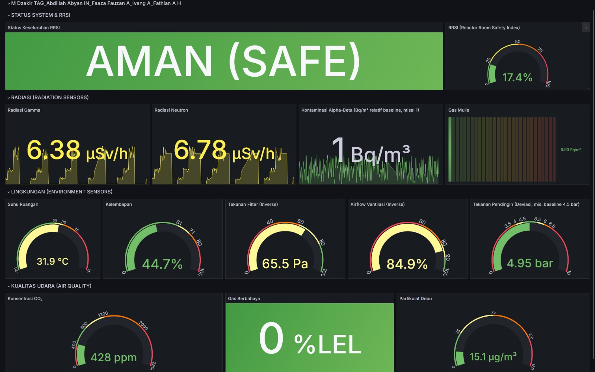
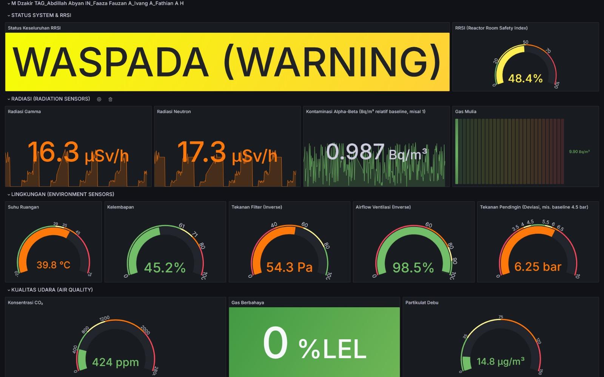
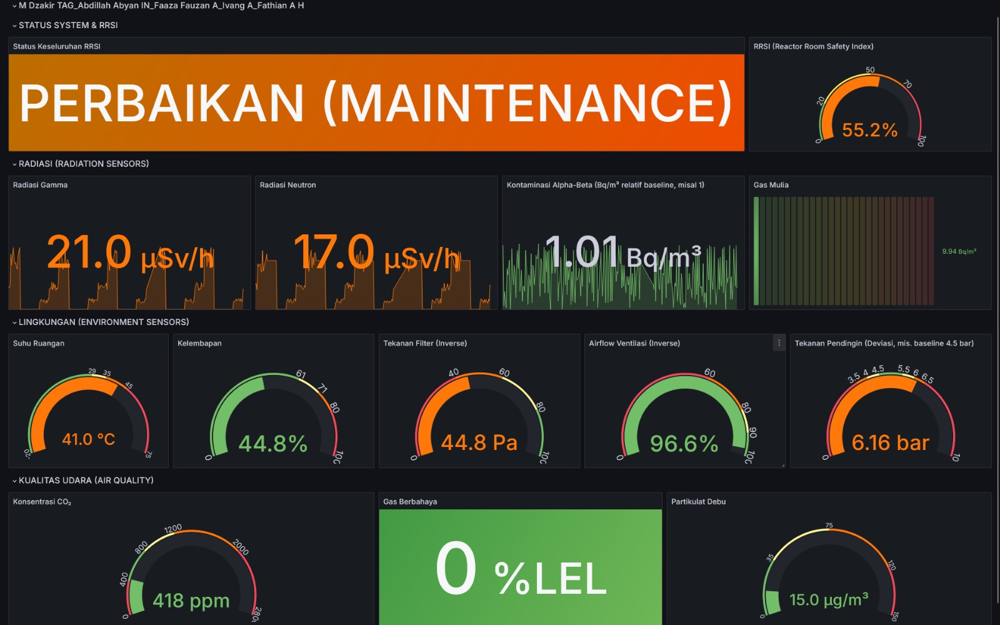
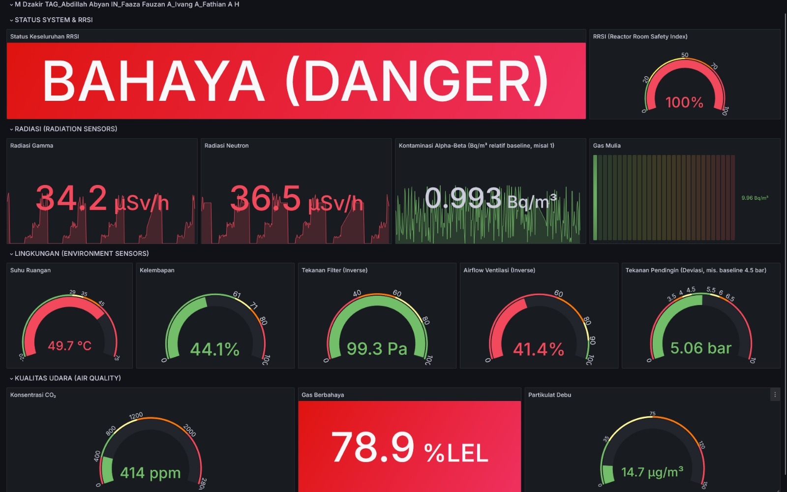
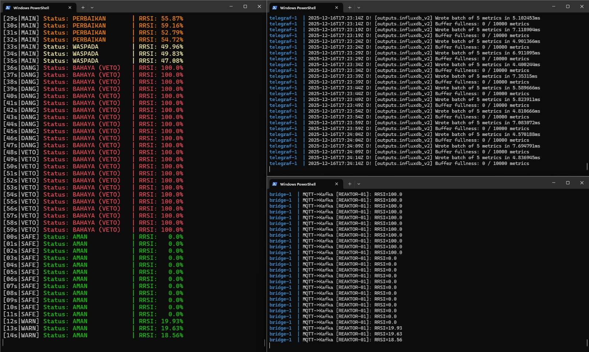

# Sistem Monitoring Ruangan Reaktor Nuklir (Real-Time Streaming ELT Pipeline)


Sistem pemantauan kondisi ruangan reaktor nuklir secara *real-time* berbasis rekayasa data modern (**Streaming Extract-Load-Transform / ELT**). Sistem ini mengintegrasikan **12 parameter sensor industri kritis** yang mencakup sensor radiasi ionisasi, lingkungan operasional/pendingin, serta kualitas udara dan gas berbahaya. Dilengkapi dengan perhitungan agregat **Reactor Room Safety Index (RRSI)** berskala `0–100` dan mekanisme keselamatan berlapis (**Critical Override / Veto Fail-Safe**) sesuai standar keselamatan **IAEA** dan **BAPETEN**.

---

## Arsitektur Sistem (Streaming ELT Pipeline)

Berbeda dengan pendekatan ETL konvensional yang melakukan transformasi berat sebelum penyimpanan, sistem ini mengadopsi paradigma **Streaming ELT (Extract - Load - Transform)** untuk meminimalkan latensi (*low-latency ingestion*) dan menjaga keutuhan data mentah (*raw telemetry*) di dalam basis data *time-series* sebagai bukti audit keselamatan maupun forensik digital.

```mermaid
flowchart LR
    subgraph Layer1["1. Sensor & Edge Layer (Extract)"]
        S["12 Sensor Industri Reaktor\n(Simulator Python)"]
        M["MQTT Broker\n(Eclipse Mosquitto :1883)"]
        B["MQTT-to-Kafka Bridge\n(Python Consumer/Producer)"]
        S -->|Publish Telemetry JSON| M
        M -->|Subscribe Topic| B
    end

    subgraph Layer2["2. Message Bus & Ingestion (Load)"]
        K["Apache Kafka + Zookeeper\n(Topic: reactor-sensors :9092)"]
        T["Telegraf Agent\n(Kafka Consumer Plugin)"]
        I[("InfluxDB v2.7\n(Time-Series DB :8086)")]
        B -->|Produce Stream| K
        K -->|Consume Batch| T
        T -->|Write Raw Metrics| I
    end

    subgraph Layer3["3. Analytics & Visualization (Transform)"]
        G["Grafana Dashboard\n(Flux Query, RRSI & Veto Logic :3000)"]
        I -->|Query & Transform| G
    end
```



### Tahapan Pipeline ELT
1. **Extract (Sensor Layer & MQTT-to-Kafka Bridge):**
   - Simulator membangkitkan data telemetri *real-time* dari **12 sensor industri** pada ruangan reaktor (`REAKTOR-01`) dan mengirimkannya melalui protokol ringan **MQTT** (`Eclipse Mosquitto`).
   - Layanan **Python Bridge** menjembatani pesan dari topik MQTT menuju *distributed streaming platform* **Apache Kafka** untuk menjamin urutan pesan (*message ordering*), *high-throughput buffering*, dan toleransi kegagalan (*fault tolerance*).
2. **Load (Telegraf & InfluxDB Time-Series Storage):**
   - **Telegraf** bertindak sebagai *ingestion agent* yang mengonsumsi *stream* data dari topik Kafka dan langsung memuatnya (*Load*) ke dalam **InfluxDB** (`bucket: iot`, `measurement: reactor_metrics`) tanpa memodifikasi nilai aslinya.
   - Penyimpanan data mentah secara langsung memastikan rekam jejak historis kondisi reaktor tersimpan utuh untuk keperluan audit keselamatan jangka panjang.
3. **Transform (Grafana & Safety Engine):**
   - Proses transformasi data, normalisasi skor sensor ($S_i$), pembobotan prioritas ($W_i$), kalkulasi **Reactor Room Safety Index (RRSI)**, evaluasi *threshold* 4-tingkat, hingga logika **Critical Override (Veto)** dieksekusi secara dinamis pada saat *query* dan visualisasi di **Grafana** serta monitor observabilitas terminal.

---

## 12 Parameter Sensor Industri & Ambang Batas (4-Tier Thresholds)

Sistem memantau **12 instrumen sensor industri** yang dikelompokkan ke dalam **3 kategori utama** dengan **4 tingkatan ambang batas keselamatan** (*Safe*, *Warning*, *Maintenance*, dan *Danger*):

### 1. Kategori Sensor Radiasi (Radiation Sensors)
| No | Parameter Sensor | Instrumen Referensi | Satuan | Aman (Safe) | Waspada (Warning) | Perbaikan (Maintenance) | Bahaya (Danger) |
| :-: | :--- | :--- | :---: | :---: | :---: | :---: | :---: |
| 1 | **Radiasi Gamma** | Bosean FS-5000 | `µSv/h` | $\le 0.5$ | $0.5 - 10$ | $10 - 25$ | $> 25$ |
| 2 | **Radiasi Neutron** | Detektor Neutron HT-50 | `µSv/h` | $\le 0.5$ | $0.5 - 10$ | $10 - 25$ | $> 25$ |
| 3 | **Kontaminasi Alpha-Beta Udara** | Mirion iCAM Air Monitor | `Bq/m³` *(relatif baseline)* | $< 5\times$ baseline | $5 - 10\times$ baseline | $10 - 20\times$ baseline | $> 20\times$ baseline |
| 4 | **Gas Mulia Radioaktif (Xe/Kr)** | Noble Gas Monitor NGM-202L | `Bq/m³` | $< 50$ | $50 - 300$ | $300 - 1000$ | $> 1000$ |

### 2. Kategori Sensor Lingkungan & Pendingin (Environment & Cooling Sensors)
| No | Parameter Sensor | Instrumen Referensi | Satuan | Aman (Safe) | Waspada (Warning) | Perbaikan (Maintenance) | Bahaya (Danger) |
| :-: | :--- | :--- | :---: | :---: | :---: | :---: | :---: |
| 5 | **Suhu Ruangan** | RTD Platinum PT100 | `°C` | $20 - 28$ | $29 - 35$ | $36 - 45$ | $> 45$ |
| 6 | **Kelembapan Relatif** | Vaisala HMT330 | `% RH` | $30 - 60$ | $61 - 70$ | $71 - 80$ | $> 80$ |
| 7 | **Tekanan Diferensial Filter HEPA** | Setra 267 Diff. Pressure | `Pa` *(% desain)* | $\ge 80\%$ desain | $60 - 79\%$ | $40 - 59\%$ | $< 40\%$ |
| 8 | **Aliran Udara Ventilasi (Airflow)** | TSI 8455 Airflow Transducer | `% desain` | $\ge 90\%$ | $80 - 89\%$ | $60 - 79\%$ | $< 60\%$ |
| 9 | **Tekanan Sistem Pendingin** | WIKA S-20 Pressure Transmitter | `bar` *(% nominal)* | $\pm 10\%$ deviasi | $10 - 20\%$ deviasi | $20 - 30\%$ deviasi | $> 30\%$ deviasi |

### 3. Kategori Sensor Gas & Kualitas Udara (Gas & Air Quality Sensors)
| No | Parameter Sensor | Instrumen Referensi | Satuan | Aman (Safe) | Waspada (Warning) | Perbaikan (Maintenance) | Bahaya (Danger) |
| :-: | :--- | :--- | :---: | :---: | :---: | :---: | :---: |
| 10 | **Konsentrasi $\text{CO}_2$** | Vaisala CARBOCAP GMP252 | `ppm` | $400 - 800$ | $800 - 1200$ | $1200 - 2000$ | $> 2000$ |
| 11 | **Gas Berbahaya / Mudah Terbakar** | Dräger Polytron 8100 EC | `% LEL` | $< 10\%$ | $10 - 20\%$ | $20 - 40\%$ | $> 40\%$ |
| 12 | **Partikulat Udara (Debu/Aerosol)** | Sharp GP2Y1010AU0F | `µg/m³` | $< 35$ | $35 - 75$ | $75 - 120$ | $> 120$ |

---

## Perumusan Reactor Room Safety Index (RRSI) & Mekanisme Veto

Untuk menyederhanakan kompleksitas 12 parameter sensor menjadi satu indikator komprehensif yang mudah diinterpretasikan oleh operator ruang kendali, sistem merumuskan **Reactor Room Safety Index (RRSI)** dengan rentang nilai **`0` (Sangat Aman)** hingga **`100` (Bahaya Ekstrem)**.

### 1. Normalisasi Skor Sensor ($S_i$)
Setiap nilai pembacaan aktual sensor ke-$i$ ($V_i$) dinormalisasi menggunakan rumus interpolasi linear terbatas (*clamped linear interpolation*) terhadap batas aman ($V_{\text{safe}}$) dan batas bahaya ($V_{\text{danger}}$):

$$S_i = \text{clamp}\left( \left( \frac{V_i - V_{\text{safe}}}{V_{\text{danger}} - V_{\text{safe}}} \right) \times 100, \; 0, \; 100 \right)$$

* Jika $V_i \le V_{\text{safe}}$, maka skor $S_i = 0$.
* Jika $V_i \ge V_{\text{danger}}$, maka skor $S_i = 100$.

### 2. Bobot Prioritas Parameter ($W_i$)
Mengacu pada prinsip keselamatan nuklir (*Defence in Depth*), parameter radiasi memiliki dampak paling fatal sehingga diberikan bobot prioritas tertinggi:

| Parameter Sensor | Bobot Prioritas ($W_i$) | Rasionalisasi Keselamatan |
| :--- | :---: | :--- |
| **Radiasi Gamma** (Bosean FS-5000) | **30%** (`0.30`) | Indikator utama *area dose rate* dan integritas *shielding* reaktor |
| **Radiasi Neutron** (HT-50) | **20%** (`0.20`) | Berhubungan langsung dengan reaksi fisi inti dan kebocoran *reactor hall* |
| **Gas Mulia Radioaktif** (NGM-202L) | **8%** (`0.08`) | Deteksi dini kegagalan *fuel cladding* (pelepasan gas inert Xenon/Krypton) |
| **Suhu Ruangan** (PT100) | **8%** (`0.08`) | Menjaga stabilitas termal instrumen kendali dan beban HVAC |
| **Tekanan Sistem Pendingin** (WIKA S-20) | **8%** (`0.08`) | Komponen kritikal pembuangan panas reaktor (*coolant loop*) |
| **Tekanan Diferensial Filter** (Setra 267) | **6%** (`0.06`) | Menjamin efektivitas penyaringan partikulat radioaktif pada filter HEPA |
| **Airflow Ventilasi** (TSI 8455) | **6%** (`0.06`) | Menjaga *negative pressure* dan sirkulasi udara terkontrol |
| **Kontaminasi Alpha-Beta** (iCAM) | **4%** (`0.04`) | Memantau pelepasan aerosol radioaktif ke udara ruangan |
| **Kelembapan Ruangan** (HMT330) | **4%** (`0.04`) | Mencegah kondensasi dan korosi pada modul elektronik |
| **Gas & Debu** ($\text{CO}_2$, Polytron, Partikulat) | **Total 6%** (`3 × 0.02`) | Indikator kualitas udara kerja, kebocoran gas eksplosif (%LEL), dan filtrasi |
| **Total Bobot ($\sum W_i$)** | **100%** (`1.00`) | |

Rumus agregat **RRSI**:

$$\text{RRSI} = \sum_{i=1}^{12} \left( S_i \times W_i \right)$$

### 3. Klasifikasi Status Operasional Berdasarkan RRSI
| Rentang Nilai RRSI | Status Sistem | Tindakan Operasional Standar |
| :---: | :---: | :--- |
| **`0.0 – 20.0`** | **AMAN (`SAFE`)** | Operasi normal, seluruh parameter berada dalam rentang *baseline* desain. |
| **`20.0 – 50.0`** | **WASPADA (`WARNING`)** | *Early warning*; peningkatan observasi operator terhadap fluktuasi awal lingkungan. |
| **`50.0 – 70.0`** | **PERBAIKAN (`MAINTENANCE`)** | Degradasi performa peralatan fisik (misal filter HEPA jenuh / *airflow* turun); jadwalkan inspeksi teknisi. |
| **`70.0 – 100.0`** | **BAHAYA (`DANGER`)** | Kondisi darurat; penghentian operasi, isolasi ventilasi, dan prosedur evakuasi area. |

### 4. Mekanisme Critical Override (Veto Fail-Safe)
> [!CAUTION]
> **Prinsip Keselamatan Berlapis (Critical Override / Hak Veto):**
> Dalam kondisi normal, status ruangan ditentukan oleh nilai agregat **RRSI**. Namun, apabila **satu saja sensor kritis** (seperti Radiasi Gamma, Radiasi Neutron, atau Gas Berbahaya/Eksplosif) menyentuh ambang batas **Bahaya (`DANGER` / $S_i = 100$)**, sistem secara otomatis mengaktifkan **VETO (`DANGER VETO`)** dan memaksa status ruangan menjadi **BAHAYA**, meskipun nilai rata-rata tertimbang RRSI secara keseluruhan masih rendah (misalnya $\text{RRSI} = 21.6$ karena 11 sensor lainnya dalam kondisi *Safe*). Mekanisme ini menjamin bahwa lonjakan radiasi fatal atau kebocoran gas eksplosif tidak akan pernah teredam oleh rata-rata matematis sensor lingkungan lainnya.

---

## Dokumentasi Visual & Tangkapan Layar Prototipe

Berikut adalah hasil implementasi visualisasi *real-time* pada **Grafana Dashboard** dan **Output Terminal** untuk kelima skenario pengujian operasional:

### 1. Kondisi Aman (`SAFE STATE`)
Seluruh parameter radiasi, lingkungan, dan kualitas udara berada dalam batas operasi normal. Nilai RRSI rendah (`17.4%`), menunjukkan sistem ventilasi, pendingin, dan perisai radiasi berfungsi optimal.


### 2. Kondisi Waspada (`WARNING STATE`)
Beberapa parameter mengalami deviasi awal dari *baseline* normal (seperti kenaikan suhu dan penurunan tekanan filter), meningkatkan nilai RRSI ke rentang Waspada (`48.4%`) sebagai sinyal *early warning* bagi operator.


### 3. Kondisi Perbaikan (`MAINTENANCE STATE`)
Terdeteksi penurunan performa peralatan fisik seperti kenaikan suhu ruangan (`41.0 °C`), penurunan tekanan diferensial filter HEPA (`44.8 Pa`), dan deviasi tekanan pendingin (`6.16 bar`). Nilai RRSI mencapai `55.2%` dan memicu instruksi pemeliharaan preventif oleh teknisi.


### 4. Kondisi Bahaya & Veto (`DANGER / DANGER VETO STATE`)
Lonjakan kritis pada parameter radiasi Gamma (`34.2 µSv/h`), Neutron (`36.5 µSv/h`), suhu ekstrem (`49.7 °C`), serta konsentrasi gas berbahaya (`78.9 %LEL`) memicu status **BAHAYA (`DANGER`)** dengan indeks mencapai `100%`, mengaktifkan protokol darurat dan evakuasi.


### 5. Observabilitas Log & Ingestion (`OUTPUT TERMINAL`)
Tampilan log terminal menampilkan aliran data *real-time* dari simulator sensor -> MQTT -> Bridge -> Kafka -> Telegraf -> InfluxDB, lengkap dengan evaluasi status (`SAFE`, `WARN`, `MAIN`, `DANG`, dan `VETO`) secara transparan.


---

## Panduan Menjalankan Sistem (Quick Start)

Seluruh komponen infrastruktur (*Mosquitto MQTT*, *Zookeeper*, *Apache Kafka*, *Python Bridge*, *Telegraf*, *InfluxDB*, *Grafana*, dan *Sensor Simulator*) telah dikemas menggunakan **Docker Compose**.

### Prasyarat
- **Docker** & **Docker Compose** telah terinstal dan berjalan di sistem Anda.

### Langkah Menjalankan
1. **Clone atau buka direktori repositori ini:**
   ```bash
   cd 01-nuclear-reactor-room-monitoring-elt
   ```

2. **Jalankan seluruh layanan kontainer dengan Docker Compose:**
   ```bash
   docker-compose up --build
   ```
   *(Tambahkan flag `-d` jika ingin menjalankan di latar belakang / detached mode).*

3. **Akses Antarmuka Layanan:**
   - **Grafana Dashboard:** `http://localhost:3000`
   - **InfluxDB Data Explorer UI:** `http://localhost:8086`
   - **MQTT Broker Endpoint:** `localhost:1883`
   - **Apache Kafka Broker:** `localhost:9092`

4. **Menghentikan Layanan:**
   ```bash
   docker-compose down
   ```

---

## Tim Pengembang
**Program Studi Teknik Komputer — Fakultas Ilmu Komputer, Universitas Brawijaya**
* **M Dzakir Thuha Al Ghaffar** (245150307111004)
* **Abdillah Abyan Ilman Nafian** (245150300111003)
* **Faaza Fauzan Adzim** (245150307111010)
* **Ivang Arfandia** (245150307111003)
* **Fathian Auzaie Hanzalah** (245150307111007)
